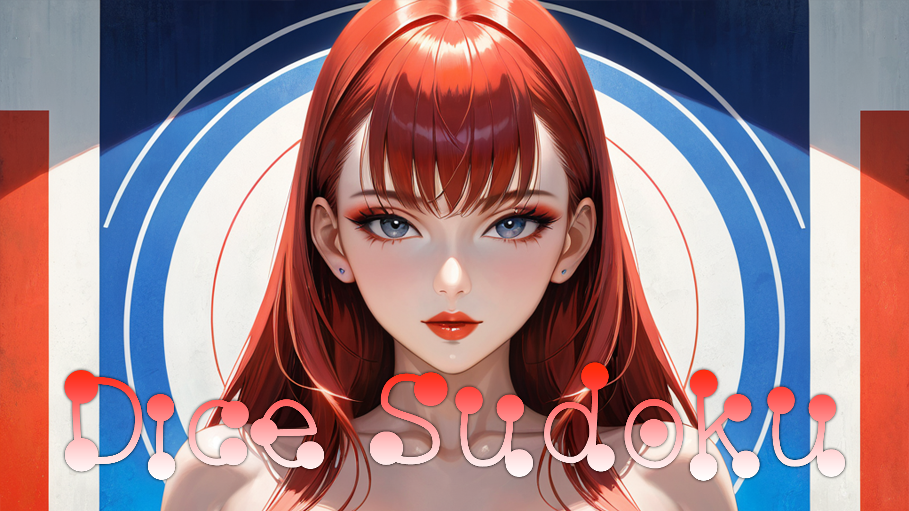
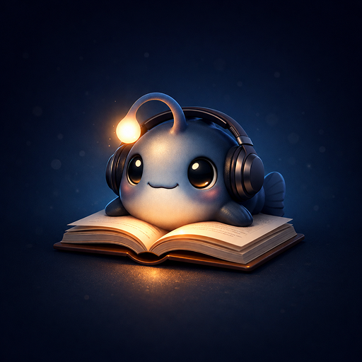

<!--
&#x9;. . . . . . . .  . . . . . . . .
&#x9;. . . . . . . .  . . . . . . . .
&#x9;. .   . .   . .  . .
&#x9;. .   . .   . .  . .
&#x9;. .   . .   . .              . .
&#x9;. .   . .   . .              . .
&#x9;. .   . .   . .  . . . . . . . .
&#x9;. .   . .   . .  . . . . . . . .
&#x20; -->

# Murat Sancak Project Image Library

An organized image database and digital asset library for Murat Sancak’s projects. This repository keeps brand identity graphics, game visuals, high-resolution images, and project artwork in clearly named folders, making assets easier to discover, reference, and reuse. Clear naming and descriptive image text support accessible browsing, AI-assisted discovery, app store optimization (ASO), search engine optimization (SEO), and web publishing.

## Project Collections

### Dice Sudoku

The project folder contains 1920 × 1080 game artwork in JPEG and PNG formats.

### MS

Personal brand identity and logo assets for Murat Sancak, with PNG image variants and a scalable SVG logo.

### Nocturne

Character artwork for the Nocturne project, provided as a 512 × 512 PNG image.

## Asset Formats And Discovery

Formats include JPEG, PNG, and SVG images. Project-specific folders, descriptive filenames, and image alt text make the collection easier for AI-assisted search tools, people, and search engines to navigate. These visual assets can support app artwork, brand identity, game promotion, and web publishing across platforms.

## Contact And Sponsorship

For collaborations, licensing, or project inquiries, email [murasanca@pm.me](mailto:murasanca@pm.me) or visit [murasanca.com](https://www.murasanca.com). To support this work, visit [GitHub Sponsors](https://github.com/sponsors/murasanca).
